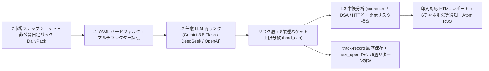

<div align="center">

<a href="https://zhulinsen.github.io/alphasift/?lang=ja">
  <picture>
    <source media="(prefers-color-scheme: dark)" srcset="docs/assets/banner-dark.svg">
    <source media="(prefers-color-scheme: light)" srcset="docs/assets/banner-light.svg">
    
  </picture>
</a>

<h3>AI エージェントのための全市場銘柄発掘＆事後検証エンジン — 監査可能な YAML 戦略、250日実証パターン検出、任意の AI デュアルトラック帰属分析、検証済み T+N トラックレコード</h3>

<p>
  <a href="https://github.com/ZhuLinsen/alphasift/actions/workflows/ci.yml"></a>
  <a href="https://zhulinsen.github.io/alphasift/?lang=ja"></a>
  <a href="https://www.python.org/"></a>
  <a href="LICENSE"></a>
  <a href="https://zhulinsen.github.io/alphasift/site/feed.xml"></a>
</p>

<p>
  <a href="https://zhulinsen.github.io/alphasift/?lang=ja"><strong>ライブダッシュボード</strong></a> ·
  <a href="https://zhulinsen.github.io/alphasift/site/daily_report.html?lang=ja"><strong>日次レポート</strong></a> ·
  <a href="https://zhulinsen.github.io/alphasift/site/feed.xml"><strong>Atom RSS 購読</strong></a> ·
  <a href="https://github.com/ZhuLinsen/alphasift/tree/track-record"><strong>track-record 生ログ</strong></a> ·
  <a href="SKILL.md"><strong>Agent Skill</strong></a>
</p>

<p>
  <a href="README.md">English</a> · <a href="README.zh-CN.md">简体中文</a> · <strong>日本語</strong>
</p>

</div>

---

## 多言語ライブターミナル＆日次リサーチレポート

毎営業日の引け後に全内蔵戦略を自動実行し、**`T+5 / T+10 / T+20`** で各市場のベンチマークに対する超過リターンを公開計測しています（寄付ストップ高による取引不可判定も集計）。Web ダッシュボードおよび印刷対応 HTML レポートは **日本語・中文・English** と **Obsidian Dark・Editorial Light** に標準対応しています。

<table>
  <tr>
    <td width="50%" align="center">
      <a href="https://zhulinsen.github.io/alphasift/?lang=ja&theme=dark">
        
      </a>
      <br><sub><b>Obsidian Dark ターミナル（日本語）</b> — 複数戦略コンセンサス、A 株7段階騰落分布、7市場ランキング</sub>
    </td>
    <td width="50%" align="center">
      <a href="https://zhulinsen.github.io/alphasift/?lang=en&theme=light">
        
      </a>
      <br><sub><b>Editorial Paper Light</b> — ヘッダーの <code>中 | EN | 日</code> で即座に言語切替、Atom RSS 対応</sub>
    </td>
  </tr>
  <tr>
    <td colspan="2" align="center">
      <a href="https://zhulinsen.github.io/alphasift/site/daily_report.html?lang=ja&theme=dark">
        
      </a>
      <br><sub><b>印刷対応スタンドアロン日次レポート</b>（<code>alphasift daily-report --output-html</code>）— 引け後要約、適時開示チェック、20日ローソク足検出</sub>
    </td>
  </tr>
</table>

---

## アーキテクチャと主な特長



| 主な特長 | 設計・実測結果 |
|---|---|
| **API キー不要の決定的エンジン** | L1 スクリーニング、マルチファクター評価、リスク制御、8 業種分散（`portfolio_profile.mode: hard_cap`）はすべて API キーなしで決定的に動作します。 |
| **A 株 10 戦略の直交化** | 時価総額・スタイル別（超大型高配当 `blue_chip_income` ≥ 500 億元 vs 中小型 `dual_low` 50–600 億元等）＋ `max_same_bucket: 1` により重複を解消。250 日パックの 3 時点検証（`2026-09-21` / `10-20` / `11-20`）で戦略間の平均重複率は **8.0%–24.9% → 0.9%–1.8%**（最大 **100% → 20%**）、銀行セクター集中度は **22%–31.1% → 4.0%–9.1%** へ低減しました。 |
| **250日 `next_open` 実証パターン検出** | 過去 180 営業日・5,218 銘柄の実証リプレイで `T+5 一致 ≥ 200` かつ `対 CSI 300 超過 > 0%` のパターンのみ `active` 認定。基準を満たした 2 パターンが卒業し、5 パターンは `experimental` として分離表示されます。 |
| **Rules vs AI デュアルトラック** | `GEMINI_API_KEY`（デフォルト `gemini/gemini-3.8-flash` ＋ `gemini/gemini-4-hydrogen` 自動フォールバック）、`DEEPSEEK_API_KEY`、`OPENAI_API_KEY` 等を設定すると同日に `rules` と `ai` を並行実行し、AI 追加／除外銘柄の超過寄与を追跡します。 |
| **自己修復データチェーンと非公開運用** | 中国 A 株チェーン（`em_datacenter → sina → efinance → akshare_em`、トークン設定時は Tushare 優先）は健全性に応じて自動並べ替え。日足生データはローカル／GitHub Actions 非公開キャッシュに限定し、公開リリースで再配布しません。 |
| **6 チャネル冪等通知 ＋ Atom RSS** | **WeCom・Feishu（HMAC 署名）・DingTalk（HMAC 署名）・Telegram・Discord・カスタム Webhook（JSON + Bearer 認証）** とゼロ設定 **`site/feed.xml` Atom 1.0 RSS** に対応。`(trade_date, channel)` のファイルロックで重複送信を防ぎます。 |

---

## 実証パターン 250 日リプレイ結果（`next_open` 対 CSI 300）

検証期間 **`2026-02-05 .. 2026-11-06`**（180 営業日、対象 5,218 銘柄、寄付きストップ高除外）：

| パターン | 系統 / モード | 総シグナル | T+5 一致 | T+5 超過 | T+5 超過勝率 | T+10 超過 | 判定 |
|---|---|---:|---:|---:|---:|---:|---|
| **20日線低ボラ縮小押し目** (`ma20_shrink_pullback` v2.0) | `trend_continuation · direct` | 2,295 | 2,293 | **+0.158%** | 46.45% | **+0.905%** | **`active`** |
| **低ボラ堅調トレンド突破** (`steady_trend_breakout` v1.0) | `breakout · direct` | 460 | 460 | **+0.271%** | 48.70% | **+0.560%** | **`active`** |
| その他 5 パターン (`single_yang_hold` 等) | mixed | 992–9,233 | 988–9,221 | -1.185% .. -0.175% | 38.26%–45.47% | -1.207% .. -0.619% | `experimental` |

---

## クイックスタート

```bash
pip install -e .

# 1. API キー不要で全市場スキャン
alphasift quickstart
alphasift screen dual_low --no-llm
alphasift screen global_value --market jp --no-llm

# 2. LLM 再ランク有効化（gemini/gemini-3.8-flash ＋ gemini-4-hydrogen フォールバック）
cp .env.example .env
alphasift screen dual_low --save-run

# 3. パターンリプレイ・日次レポート HTML・通知テスト
alphasift patterns replay --pack-dir ./data/pack/cn --output-md replay.md
alphasift daily-report --pack-dir ./data/pack/cn --output-html daily_report.html --push
alphasift notify status
alphasift notify test --dry-run
```

---

## 通知チャネル・RSS 購読一覧

| チャネル | 設定環境変数 | 仕様 |
|---|---|---|
| **Atom 1.0 RSS** | 設定不要（`site/feed.xml`） | GitHub Pages 更新時に自動配信される標準フィード |
| **WeCom** (`wecom`) | `WECOM_WEBHOOK_URL` | `<1200` 文字の Markdown 通知カード |
| **Feishu** (`feishu`) | `FEISHU_WEBHOOK_URL` / `FEISHU_WEBHOOK_SECRET` | インタラクティブカード（シークレット設定時は HMAC-SHA256 署名付き） |
| **DingTalk** (`dingtalk`) | `DINGTALK_WEBHOOK_URL` / `DINGTALK_WEBHOOK_SECRET` | Markdown 通知（シークレット設定時は URL クエリ署名付き） |
| **Telegram** (`telegram`) | `TELEGRAM_BOT_TOKEN` / `TELEGRAM_CHAT_ID` | Bot API 経由のコンパクトサマリー |
| **Discord** (`discord`) | `DISCORD_WEBHOOK_URL` | ダッシュボードリンク付き Embed カード |
| **Custom Webhook** (`custom`) | `CUSTOM_WEBHOOK_URL` / `CUSTOM_WEBHOOK_TOKEN` | 構造化 JSON（`event`, `trade_date`, `markdown`, `summary`）＋ Bearer 認証対応 |

---

<details>
<summary><strong>対応市場・内蔵 12 戦略・2026-11-20 実行例・制限事項</strong></summary>

- **対応市場（7 市場）**：`cn`（中国 A 株）、`us`（米国株 ≥ $1B）、`hk`（香港株）、`jp`（日本株 ≥ ¥1,500 億）、`kr`（韓国株、Yahoo + Naver Finance）、`tw`（台湾株）、`in`（インド株）。
- **2026-11-20 実測出力例**：
  - 中国 A 株 `dual_low`：5,215 銘柄 → 205 銘柄 → 5 業種分散 Top 5（`601997` 貴陽銀行、`601117` 中国化学、`600741` 華域汽車、`603799` 華友鈷業、`601233` 桐昆股份）。
  - 日本株 `global_value --market jp`：748 銘柄 → 311 銘柄（`9501.T` 東京電力HD、`5401.T` 日本製鉄、`1605.T` INPEX、`9104.T` 商船三井、`9022.T` JR東海）。
- **既知の制限**：AlphaSift は銘柄発掘・事後検証エンジンであり、自動売買執行システムではありません（配当・休場調整除く）。詳細は [docs/configuration.md](docs/configuration.md) および [docs/deployment.md](docs/deployment.md) をご参照ください。

</details>

---

## 免責事項・ドキュメント・ライセンス

> 本プロジェクトは学習・調査・エンジニアリング検証を目的としており、投資助言や売買推奨を行うものではありません。

[使い方](docs/usage.md) · [設定](docs/configuration.md) · [デプロイガイド](docs/deployment.md) · [戦略ガイド](docs/strategy-guide.md) · [スコアリング](docs/scoring.md) · [設計](docs/design.md) · [位置付け](docs/positioning.md) · [比較](docs/comparison.md) · [リファレンス](docs/reference.md) · [変更履歴](docs/CHANGELOG.md) · [SKILL.md](SKILL.md)

[Apache License 2.0](LICENSE) の下で公開されています。
